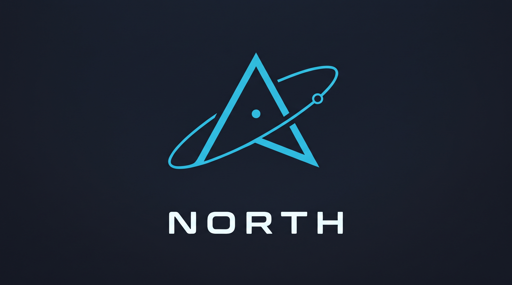

<p align="center"></p>

North checks and lands changes from coding agents on main, with no person in the loop.
An agent works in its own lane worktree inside the worker sandbox, checks its change against the
repository's deterministic gates and public-repo scans, and hands it in; the lander rebases the
lane onto main, runs a one-shot security read when ring-0 paths or dependencies change, pushes,
and reverts a lane whose after-landing checks fail. It wraps the command-line clients you already
use (Claude Code, OpenCode and Pi), adding the sandbox, the policy switches and the lander.

## Measured result

On small tasks north lands a change in 12 s against T3 Code's 16 s at one worker and 13 s against 21 s at five at once, at about 0.3 of the cost (15 pairs per cell; method and every row on [the comparison page](docs/rationale/plain-runner-comparison.md)).

## Quickstart

You need x86_64 Linux with Nix and flakes, `git`, and Claude Code installed and signed in. The command
clones and builds north, makes an account profile from the Claude Code login, has one agent land one
change on a scratch repository and exits 0 when it is on main ([the onboarding page](docs/onboarding.md)).

<!-- north docs readme: quickstart -->
```sh
nix run github:tompassarelli/north#setup
```
<!-- end quickstart -->

Then put `~/code/north/main/target/debug` on your `PATH` and run `north --help` to list its commands.

## How a change lands

1. **Box.** An issue's box carries a `Done when:` line with a command, the check that closes it.
2. **Work.** A worker session runs in its own worktree. Confined workers stay out of the main
   checkout, other lanes, secrets and ring-0 paths.
3. **Hand-in.** The session checks the lane against the repository's pre-queue gates, commits only
   the named paths and queues a ticket for the lander.
4. **Landing.** The lander rebases the lane on main, runs the checks the change touches and pushes it,
   then runs the after-landing tests the batch reaches, every test when it reaches every crate,
   and reverts a lane that breaks main ([docs/landing.md](docs/landing.md)).

The words follow [docs/terms.md](docs/terms.md): a **model** is the weights, the **harness** turns a
model into an **agent**, and a **fleet** is many agents with roles, staffing and policy.

## Where things live

- [src/](src/): the `north` command, one file per command
- [crates/](crates/): the libraries behind it, one crate per responsibility in seven layers ([ARCHITECTURE.md](ARCHITECTURE.md))
- [harness/](harness/): the hooks, skills, policy and defaults north installs into each agent
- [docs/](docs/): concept pages, one record per feature, and the rationale for each choice
- [evals/](evals/): the runners that measure north against other harnesses
- [examples/](examples/): a working operator repository with synthetic values

## Finding a fact

- [AGENTS.md](AGENTS.md): the rules for working in this repository
- [docs/README.md](docs/README.md): every page, in reading order
- [docs/features/](docs/features/): what each command is for
- [docs/rationale/](docs/rationale/): why it is built this way

## License

MIT or Apache-2.0, at your choice: [LICENSE-MIT](LICENSE-MIT), [LICENSE-APACHE](LICENSE-APACHE).
