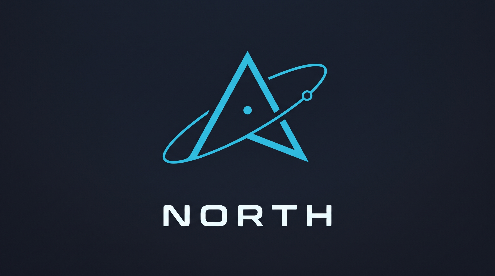

<p align="center"></p>

North turns an issue with a runnable check into a change landed on main, with no person in the loop.
You write what you want and the command that proves it is done; north writes a brief, staffs a coding
agent on a model and account that has room, guards each of its tool calls, checks the change it hands
in, lands it on main, and reverts it if main breaks. It drives the command-line clients you already
use (Claude Code, Codex, OpenCode and Pi), so it adds the staffing, the guards and the landing, not
another model. You direct the fleet from `north`, one terminal screen for talking to the coordinator,
starting work, answering decisions and seeing what landed.

## Measured result

North against T3 Code, a plain runner around the same Claude Code agent, on the same tasks with the
same model, in the two small-task cells measured so far. Each result holds for the cell it names, and every cell stays undecided until T3 Code's noise band is measured; large tasks, which a general claim needs, have not run. The numbers are computed from the committed rows in [docs/readme/comparison.toml](docs/readme/comparison.toml); the method and every row are on
[the comparison page](docs/rationale/plain-runner-comparison.md). The results north did not meet are on the same page.

<!-- north docs readme: comparison -->
Measured 2026-11-14 against T3 Code v0.1.8 on the load ladder's small tasks t01 to t05: one source edit and its acceptance check each, with claude-opus-5-5 at medium effort in every arm; both arms on one build host, its one-minute load below 2 at each start. Time runs from the launch command to the change on main. Only valid runs are counted.

| Cell | Valid runs x tasks | Landed: north / plain / given the file text | north, median | Faster T3 Code arm, median | Time ratio, each run | Time ratio, all valid runs | Cost ratio | Tokens | Reading |
|---|---|---|---|---|---|---|---|---|---|
| small one-worker cell | 1 x 5 | 5 of 5 / 5 of 5 / 5 of 5 | 15 s | given the file text, 18 s | 0.79 | 0.79 | 0.29 | 14x fewer | undecided until T3 Code's noise band is measured |
| small five-at-once cell | 2 x 5 | 10 of 10 / 10 of 10 / 10 of 10 | 13.5 s | given the file text, 21 s | 0.65, 0.61 | 0.64 | 0.28 | 9x fewer | undecided until T3 Code's noise band is measured |
| small one-worker cell on the later release runtime, cold start (the registered three-run set) | 1 x 5 | 5 of 5 / 5 of 5 / 5 of 5 | 17 s | given the file text, 19 s | 0.95 | 0.95 | 0.44 | 9x fewer | undecided until T3 Code's noise band is measured |
| small five-at-once cell on the later release runtime, cold start (the registered three-run set) | 1 x 5 | 5 of 5 / 5 of 5 / 5 of 5 | 12 s | given the file text, 25 s | 0.48 | 0.48 | 0.30 | 8x fewer | undecided until T3 Code's noise band is measured |

Time ratio: the median over tasks of north's mean time divided by the faster arm's, below 1 when north is faster; the faster arm is the one with the lower median in that cell, or in that run. Cost ratio: north's cost per task over the faster arm's, at the list price of the model, from each row's input, output, cache-read and one-hour cache-write tokens.

Not counted:

- runs 2 and 3 of the small one-worker cell, void under the protocol's load rule and not counted

Not measured yet:

- large tasks (the cells a general claim needs): not yet run
- tasks of one to ten minutes
- ten and twenty at once
- an outside benchmark
- T3 Code's noise band, without which no cell is read as ahead or behind
<!-- end comparison -->

## Quickstart

You need x86_64 Linux with Nix and flakes, `git`, and Claude Code installed and signed in. This is the
command of [the onboarding page](docs/onboarding.md), which says what it does: it clones and builds north,
makes an account profile from the Claude Code login, has one agent land one change on a scratch
repository and exits 0 when it is on main.

<!-- north docs readme: quickstart -->
```sh
nix run github:tompassarelli/north#setup
```
<!-- end quickstart -->

Then run `~/code/north/main/target/debug/north` to open the fleet screen. To run north on your own repositories, keep its
policy in an operator repository: `north config operator init DIR` writes a working one with
placeholder values, and [docs/operator-repository.md](docs/operator-repository.md) says what each
file holds.

## How a change lands

1. **Brief.** An issue's box carries a `Done when:` line with a command. North writes the brief and
   picks the tier, the account and the machine from the live usage of each ([docs/briefing.md](docs/briefing.md)).
2. **Work.** A worker session runs in its own worktree. Every tool call passes north's guards first, which
   keep it out of the main checkout, other lanes and secrets.
3. **Hand-in.** The worker calls the finish tool. North runs the box's check, commits only the paths
   named and queues the lane.
4. **Landing.** The lander rebases the lane on main, runs the checks the change touches and pushes it,
   then runs the full suite once per batch and reverts a lane that breaks main ([docs/landing.md](docs/landing.md)).
5. **Record.** Each run's tokens, time and verdict go to a ledger, and north tunes its estimates and
   routing from it ([docs/feedback-loop.md](docs/feedback-loop.md)).

The words follow [docs/terms.md](docs/terms.md): a **model** is the weights, the **harness** turns a
model into an **agent**, and a **fleet** is many agents with roles, staffing and policy.

## Where things live

<!-- north docs readme: layout -->
- [src/](src/): the `north` command: argument parsing, the composition root and the command reference and help, one file per command
- [crates/](crates/): the libraries behind it, one crate per responsibility, in the layers listed below
- [harness/](harness/): what north installs into each agent: hooks, skills, policy owners, tuned defaults and the model catalog
- [docs/](docs/): the concept pages, one record per feature, the rationale for each choice and the outside sources
- [bin/](bin/): toolchain shims and the few tools that run before north is built
- [tests/](tests/): the `north` command's integration tests and their fixtures
- [evals/](evals/): the evaluation runners that measure north against other harnesses, each its own Cargo project
- [examples/](examples/): a working operator repository with synthetic values, kept equal to what `north config operator init` writes
- [structure/](structure/): the module boundaries, crate layers and code-health limits, one file per table, joined into structure.toml
- [build/](build/): Buck2 rules for the workspace's tests
- [toolchains/](toolchains/): the Buck2 toolchains the build uses
- [third-party/](third-party/): the Buck2 targets of every outside crate, written from Cargo.lock
- [lib/](lib/): the browser-automation tool, the one part written in TypeScript
- [lint/](lint/): the Buck2 script that runs Clippy across the workspace
- [mode/](mode/): the Buck2 build modes
- [north-data/](north-data/): the expectations the fleet tick judges and the private-check list a landing reads

The crates under [crates/](crates/), by the layer each sits in; a crate depends only on layers below it, and [ARCHITECTURE.md](ARCHITECTURE.md) gives each crate's purpose:

- **1 platform**, touches the outside world (git, GitHub, processes, SQLite, ssh, Nix) and holds base values: [north-agent-starts](crates/north-agent-starts/), [north-base](crates/north-base/), [north-broker](crates/north-broker/), [north-buck](crates/north-buck/), [north-build-system](crates/north-build-system/), [north-cli-reference](crates/north-cli-reference/), [north-foundation](crates/north-foundation/), [north-git-locks](crates/north-git-locks/), [north-machine-model](crates/north-machine-model/), [north-publish](crates/north-publish/), [north-registries](crates/north-registries/), [north-runtime-follow](crates/north-runtime-follow/), [north-shared-config](crates/north-shared-config/), [north-ssh-spare](crates/north-ssh-spare/), [north-strategy-types](crates/north-strategy-types/), [north-test-cases](crates/north-test-cases/)
- **2 records**, remembers: one crate per durable store, with its schema, its one writer and its typed readers: [north-coverage](crates/north-coverage/), [north-fleet-store](crates/north-fleet-store/), [north-github-mirror](crates/north-github-mirror/), [north-graph](crates/north-graph/), [north-graph-change](crates/north-graph-change/), [north-graph-ground](crates/north-graph-ground/), [north-graph-loops](crates/north-graph-loops/), [north-threads](crates/north-threads/)
- **3 rules**, decides: a verdict from records, a diff, a tree or a tool call, with no effect beyond reading: [north-calibration](crates/north-calibration/), [north-capacity](crates/north-capacity/), [north-check-environment](crates/north-check-environment/), [north-code-health](crates/north-code-health/), [north-concerns](crates/north-concerns/), [north-context-pack](crates/north-context-pack/), [north-diff-gates](crates/north-diff-gates/), [north-guard](crates/north-guard/), [north-implicit-state](crates/north-implicit-state/), [north-land-scans](crates/north-land-scans/), [north-landing-gates](crates/north-landing-gates/), [north-mutants](crates/north-mutants/), [north-pace](crates/north-pace/)
- **4 sessions**, runs agent sessions on each provider's command-line client: [north-claude-stream](crates/north-claude-stream/), [north-fleet](crates/north-fleet/), [north-fleet-supervisor](crates/north-fleet-supervisor/), [north-providers](crates/north-providers/), [north-resume](crates/north-resume/), [north-session-host](crates/north-session-host/)
- **4 workspace**, makes and reaps the worktree each change is written in: [north-lanes](crates/north-lanes/)
- **4 landing**, checks a handed-in change and lands it on main, or refuses it with the reason: [north-land-checks](crates/north-land-checks/), [north-land-sandbox](crates/north-land-sandbox/), [north-lander](crates/north-lander/), [north-landing](crates/north-landing/), [north-safe-push](crates/north-safe-push/)
- **4 capacity**, leases machine room to builds and sessions: [north-capacity-host](crates/north-capacity-host/)
- **5 orchestration**, chooses what runs next, where, and on which build: [north-dispatch](crates/north-dispatch/), [north-offload](crates/north-offload/), [north-pacing](crates/north-pacing/), [north-runtime](crates/north-runtime/)
- **6 operations**, watches, measures, tunes, reports and repairs; nothing below depends on it: [north-claims](crates/north-claims/), [north-convo](crates/north-convo/), [north-core](crates/north-core/), [north-desktop](crates/north-desktop/), [north-docs](crates/north-docs/), [north-expectations](crates/north-expectations/), [north-flow](crates/north-flow/), [north-graph-ingest](crates/north-graph-ingest/), [north-health](crates/north-health/), [north-issue-boxes](crates/north-issue-boxes/), [north-land-watch](crates/north-land-watch/), [north-lander-doctor](crates/north-lander-doctor/), [north-ops](crates/north-ops/), [north-reclaim](crates/north-reclaim/), [north-replay](crates/north-replay/), [north-timers](crates/north-timers/), [north-tune](crates/north-tune/)
- **7 command**, the terminal screens: [north-monitor](crates/north-tui/monitor/), [north-tui](crates/north-tui/)
<!-- end layout -->

## Finding a fact

- **Working in this repository:** [AGENTS.md](AGENTS.md) holds the rules and names the page to read
  before touching each area.
- **A command or flag:** `north --help`, then `north COMMAND --help`; [docs/features/](docs/features/)
  says what each command is for.
- **A tuned number:** [harness/defaults.toml](harness/defaults.toml), each with its unit and source.
- **What a landing checks:** [.safe-push](.safe-push).
- **What north records and who reads it:** [docs/feedback-loop.md](docs/feedback-loop.md); the fact graph behind `north graph`: [docs/graph.md](docs/graph.md).
- **The fleet screen against plain Claude Code:** [docs/fleet-screen.md](docs/fleet-screen.md), each reason beside its evidence and what the plain window still does better.
- **Why it is built this way:** [docs/rationale/](docs/rationale/), dated notes.
- **The outside sources north draws on:** [docs/references.md](docs/references.md).
- **Everything else, in reading order:** [docs/README.md](docs/README.md).

Every page links to the one place that owns a fact instead of restating it, and the landing refuses a
page that names a command the binary does not have, a path that does not exist or a link that does
not resolve.

## License

MIT or Apache-2.0, at your choice: [LICENSE-MIT](LICENSE-MIT), [LICENSE-APACHE](LICENSE-APACHE).
