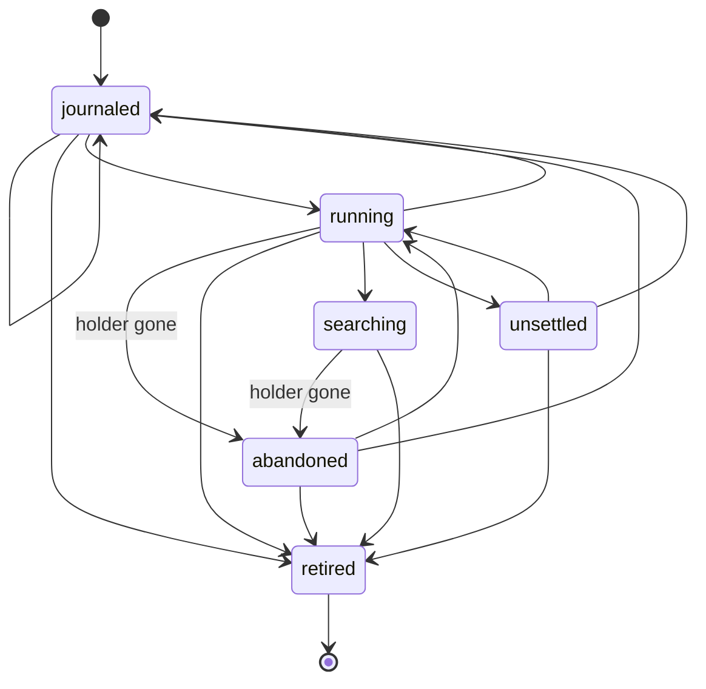

# after-landing-run state chart

Generated by `north check machines --write` from the table in `crates/north-landing/src/land/after_landing_lifecycle.rs`, driven through the lifecycle store;
do not edit. The landing refuses a page that differs from what the check generates.

- Checked: 32 situations and 951 steps, every ordering of three processes (two on one host, one on
  another) that each try every move for every holder and settle the instance, the death of the process holding
  the state, and its dwell running out.
- Held by a process, and left when that process is gone: running, searching.
- Dwell: journaled 2 h, running 4 h, unsettled 1 h, searching 2 h, abandoned 30 min.
- Ends, which an instance never leaves: retired.
- May be announced again: journaled.
- Promises checked: every accepted move is logged and the log alone rebuilds the record; a held state is taken
  from a live holder only by a move the machine lets replace one; an end has no way out, no dwell and no
  holder; a repeat is accepted exactly where promised; every other situation can be left once nothing more
  dies; every state is reached.
